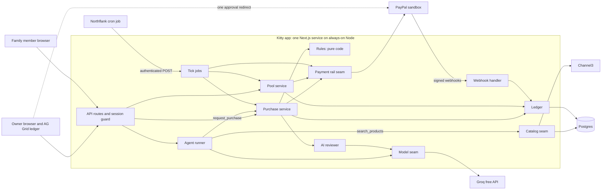
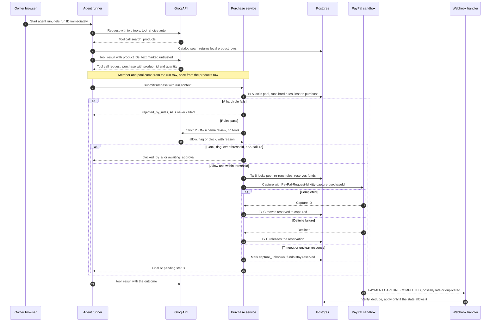
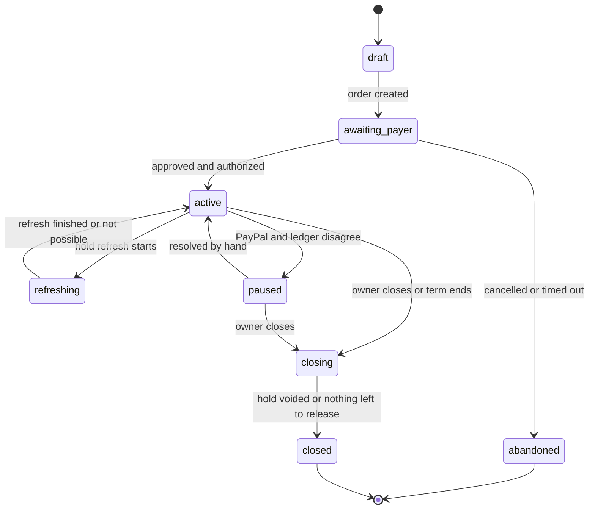
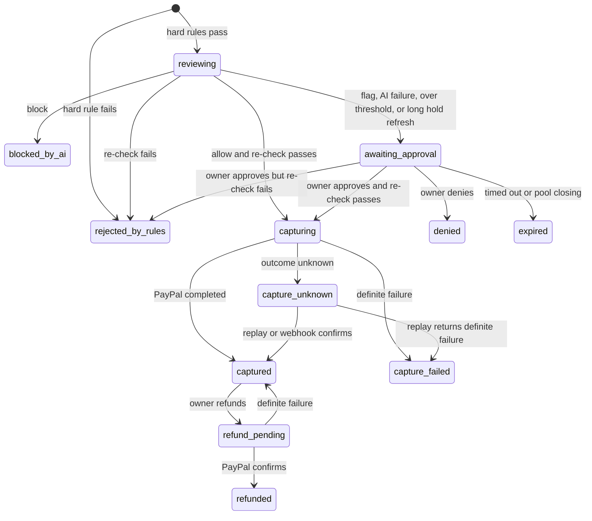

# Kitty Architecture

Based on `.claude/prds/kitty.prd.md`. This is a proposed design: nothing in it has been built or tested yet. The budget is $0, so every service below uses a free plan.

## 1. Summary

Kitty is one Next.js app on an always-on Node host, with one Postgres database and one scheduled job. An owner approves one PayPal authorization for a pool, and Kitty is the single merchant. Family members and AI agents then spend from that pool in pieces, each under their own limit, allowed stores and approval threshold. Purchases are paid to Kitty in the sandbox and no real retailer order is placed.

- **Kitty's ledger decides what can be spent.** PayPal may allow captures above the authorization, so every movement of funds happens in a Postgres transaction that locks the pool row, with database constraints as a backstop.
- **Code decides, and AI can only tighten.** Hard rules run first, in code. AI review can only flag or block. Agents spend through the same path as people.
- **Nothing slow runs inside a transaction.** AI and PayPal calls happen between short transactions. Each purchase is a row whose status says what happens next, so work can resume after a crash.
- **PayPal, Channel3 and the AI model each sit behind one seam.** If the spike rules out partial captures, Channel3's terms rule out this use or a free model falls short, an adapter changes and the purchase rules do not.
- **The design spends nothing.** No card goes on any service and no plan is upgraded. Kitty counts its own free usage and stops before each limit (section 2.1).

**[verify]** marks anything not confirmed from the project files, to be checked during the Milestone 1 spike. The design depends on PayPal behavior that is still untested (section 10).

## 2. Technology recommendations

| Decision | Choice | Why | Main alternative rejected |
|---|---|---|---|
| App | Next.js App Router and TypeScript, run with `next start` | UI, API, webhooks and agent runner ship as one deployable | Separate backend service: a second deployable with no benefit at this size |
| Host | Northflank Sandbox (free): one always-on service, its one Postgres add-on, one cron job | Free with no card and "always on, no sleeping", so webhooks, scheduling and long agent runs all work in one place **[verify]** | Render free: the web service sleeps, cron costs at least $1 a month, and free Postgres is deleted after about 44 days. Vercel Hobby: non-commercial only, and its terms list processing visitor payments as commercial use |
| Database | PostgreSQL on Northflank's free add-on | Row locks, check constraints and unique indexes carry the money rules | SQLite: weak fit for concurrent writes on a hosted service |
| Data access | Drizzle ORM with `pg`, Zod at every boundary | SQL-first migrations and row locks without raw SQL **[verify]** | Prisma: row locks need raw SQL **[verify]** |
| PayPal | Small typed `fetch` wrapper in the adapter, redirect to PayPal's approval link | Full control of `PayPal-Request-Id`, timeouts and retries, with no PayPal code in the browser | A PayPal SDK or MCP server: hides the retry behavior Kitty must own |
| AI model | Groq free plan, `openai/gpt-oss-120b` for both agent and review, through the `groq-sdk` package, behind a model seam | Free, with published limits, tool use and strict JSON-schema output, and only one model to test | Claude API: no free tier, only a small one-time credit. Gemini 3.8 Flash: free, but its limits aren't published and free-tier content is used to improve Google's products |
| Purchase review | One Groq call with strict JSON-schema output and no tools | Output limited to `allow`, `flag` or `block` plus a reason | Parsing free text: a malformed answer could be misread |
| Agent loop | Manual tool-use loop, `tool_choice: auto`, Zod validation of every tool argument | Kitty saves each step, checks the finish reason every turn, caps turns and paces itself to the free token limit | An agent framework: hides the per-turn controls Kitty needs |
| Agent execution | Background task in the always-on Node process; the request returns a run ID at once | A run can take minutes and does not fit in a request | Separate worker service: not justified yet |
| Scheduled work | Northflank cron job (the free plan includes two jobs) posts to an authenticated `/api/internal/tick` every 5 minutes | No timers in the app, and easy to trigger by hand | Redis and a job queue: more infrastructure for one job |
| Product data | Channel3 `/v1/search` behind a catalog seam, keeping only the few products each search returns | Real products with 1,000 free searches, replaceable by a seeded catalog | Channel3 MCP for the agent: the agent may have only Kitty's two tools |
| Owner ledger | AG Grid Community | Live table with sorting, filtering and Approve and Deny cells **[verify]** | AG Grid Enterprise: no required ledger feature is known to need it |
| Live updates | Poll the ledger API every 2-3 seconds | Simple and fast enough for a household | WebSockets: more to run for no visible gain |
| Access | Signed httpOnly cookie, demo personas, shared access code | Proportionate to a sandbox product | A hosted identity provider |
| Tests | Vitest on real Postgres, plus scripted sandbox scenarios | Race tests mean nothing against a mock | Mocking the database |

**AI settings.** Review and agent calls stay separate, because Groq does not support structured output and tool use together. Review uses strict JSON-schema output. Groq's pages don't confirm strict schemas on tool calls, so Zod checks every tool argument. Keep prompts short and trim product text to fit the 8,000 tokens-a-minute limit.

### 2.1 Free plans and their limits

Read from each provider's site in November 2026. Free plans change, so recheck them before relying on them.

| Service | What is free | When the limit is reached | Still to confirm |
|---|---|---|---|
| Northflank Sandbox | 2 services, 2 jobs, 1 database, up to $20 a month of resources, no card, "always on, no sleeping" | Not stated. With no card on file there is nothing to charge | CPU, memory, database size and build limits, which the pricing page doesn't give |
| Groq, `openai/gpt-oss-120b` | 30 requests a minute, 1,000 a day, 8,000 tokens a minute, 200,000 tokens a day | Reviews go to owner approval and agent runs stop | That this table is the free plan, and that no card is needed, which comes from third-party lists |
| Channel3 | 1,000 searches with no card, then about $7 per 1,000 | Kitty stops at 900 and switches to the seeded catalog | Whether the 1,000 is one-time or monthly. The price appears only on its blog |
| PayPal sandbox, AG Grid Community, public GitHub repo | Free | No known limit that affects Kitty | AG Grid features (Q9) |

**Spending rules.** Never add a card or upgrade a plan on any service. Reaching a free limit can stop a feature, and each one has a defined safe result.

## 3. Main parts

One codebase: `src/app` (pages and thin routes), `src/domain` (rules, purchases, ledger, pools, with no framework or SDK imports), `src/ai`, `src/adapters/payments`, `src/adapters/catalog`, `src/jobs`, `src/db`.

| Part | Owns | Must never |
|---|---|---|
| Web UI | Owner screens, marketplace, AG Grid ledger, polling | Compute balances, decide a rule, hold a secret or supply a price the server trusts |
| API routes | Session, input validation, owner-only guard | Contain business rules or call PayPal directly |
| Rules | A pure function for the hard rules, and the "strictest outcome wins" step | Do I/O, or treat AI output as permission |
| Purchase service | The single path for all spending, driven by purchase status | Hold a transaction open across an AI or PayPal call |
| Ledger | Every change to pool and member counters, and append-only `ledger_entries` | Make a refund spendable, or release funds on an unknown outcome |
| Pool service | Create, refresh, close | Reauthorize or void while a capture is in flight |
| AI reviewer | One structured call returning a decision and reason | Have tools, see credentials, set amounts or default to `allow` |
| Agent runner | The loop, two tools and the run context | Hold a payment credential or capture tool, or read member, pool or price from model arguments |
| Catalog seam | Channel3 or seeded data, normalized into `products` | Return a product without a local ID and local price |
| Payment rail seam | All PayPal knowledge | Apply purchase policy, or invent a new request ID for a retry |
| Model seam | All Groq knowledge, pacing and usage counts | Decide a purchase, or report a failure as `allow` |
| Webhook handler | Signature check, dedupe, forward-only state changes | Trust an unverified event, or move a record backward |
| Tick jobs | Hold refresh, expiry, stale work, replays, reconciliation | Hold a lock across a network call, or release funds with an unknown outcome |

**Payment rail seam.** One interface: `createPoolPayment`, `confirmPoolPayment`, `charge`, `refreshHold`, `releaseHold`, `refund`, `getPoolPaymentState`, `getCapture` and `verifyWebhookSignature`. Calls that change money return `succeeded`, `failed`, `unsupported` or `unknown`. The planned adapter is authorize-and-capture. The fallback adapter uses saved PayPal through Payment Method Tokens and charges each purchase separately. It needs PayPal approval and loses real reserved funds, so it sets `holdsRealFunds` to false and the UI stops saying funds are held. The ledger and rules are identical in both.

**Catalog seam.** `search` and `getProduct`, chosen by `CATALOG_PROVIDER`. Results are stored in `products`, and every caller gets a local ID and local price. Each imported product is mapped to a Kitty store. A product with no mappable store or no USD price is dropped. Channel3's terms forbid caching or storing "a significant portion" of its catalog or output, so Kitty never bulk-imports, stores only the products a search returned and removes unpurchased ones after 24 hours. Kitty shows no retailer or affiliate links. The seam counts searches and switches to the seeded catalog at 900, so the free 1,000 are not exceeded. Channel3's response fields are **[verify]**. The seeded catalog in the public repo is hand-written and no Channel3 data is committed, because its terms are still open.

**Model seam.** Two functions, chosen by `AI_PROVIDER`. `reviewPurchase` returns a decision and reason, or a failure. `agentTurn` returns tool calls, a final answer, or a failure. A failure covers errors, timeouts, rate limits, refusals, and truncated or invalid output. The seam makes one AI call at a time across the app, honors retry delays and keeps daily counts below Groq's limits. Moving to another free model means writing one adapter.

## 4. How they connect

- The browser talks only to Kitty's routes, apart from the one redirect to PayPal's approval page.
- All spending goes through the purchase service, and only the ledger changes funds.
- The ledger page reads one endpoint with a row per purchase: member, amount, rule result, AI decision and status. Rows update in place by purchase ID **[verify]**.

### Purchase: agent request through capture

## 5. The critical flows

### 5.1 Create and approve a pool

1. The owner enters a goal, amount, term and member rules. The term is capped at 28 days so every pool closes before the 29-day limit. The pool is `draft`.
2. The payment rail creates a PayPal order with `intent: AUTHORIZE`. Kitty stores the order ID, sets `awaiting_payer` and redirects the owner to PayPal.
3. The owner approves once and PayPal returns to Kitty. Kitty finds the pool by its stored order ID and calls `POST /v2/checkout/orders/{id}/authorize`.
4. Kitty saves the authorization with `honor_ends_at` (3 days) and `expires_at` (29 days), takes `authorized_cents` from PayPal's response, and sets `active`.
5. `PAYMENT.AUTHORIZATION.CREATED` confirms it. If the owner never returns, the tick marks the pool `abandoned`.

### 5.2 A purchase

Everything uses `submitPurchase(context, productId, quantity, idempotencyKey)`. The context comes from the session for a person and the `agent_runs` row for an agent. The key is a per-checkout ID for a person and `runId:toolUseId` for an agent, so a repeated call finds the same purchase.

1. **Price.** Load the product from `products`. `amount = price_cents * quantity`.
2. **Hard rules** (Tx A, pool locked). Pool is `active` and its hold is usable; requester is an active member; store is allowed; amount fits the member's remaining limit and the pool's available balance. A failure writes `rejected_by_rules` and ends the flow. A pass writes `reviewing`.
3. **AI review** (no transaction). The reviewer gets server-built facts and returns `allow`, `flag` or `block` plus a reason.
4. **Strictest outcome wins.** The rules say `proceed`, or `needs_approval` when `amount > approval_threshold_cents`, so a $0 threshold means every purchase needs approval. AI `allow` changes nothing, `flag` means `needs_approval`, and `block` means stop.
5. **Reserve** (Tx B, pool locked). Re-run the hard rules, move funds from available to reserved, store the authorization ID and set `capturing`.
6. **Capture** (no transaction). `POST /v2/payments/authorizations/{id}/capture` with a partial `amount`, `final_capture: false` and the purchase's request ID.
7. **Settle** (Tx C, pool locked). Success moves reserved to captured. A definite failure returns funds to available. An unknown outcome leaves them reserved (section 7.2).

"Usable" means the hold has not expired or been voided. A hold past its 3-day honor period still passes, with a warning, because a capture may still succeed and a failure is handled.

`refreshing` is a short pause, not a rule failure. Steps 2 and 5 wait a few seconds and try again. If the pool is still refreshing, step 2 returns "try again" and step 5 sends the purchase to `awaiting_approval`.

Funds are not reserved during review or while waiting for approval, so a slow review or a forgotten request cannot tie up money. A person's request returns after step 2 and the page polls. An agent's tool call waits for the whole flow.

### 5.3 Owner approval

1. The owner clicks Approve or Deny in the AG Grid ledger. The server checks that the session user owns the pool; the grid only displays state. Deny sets `denied`.
2. Approve opens a transaction, locks the pool, confirms the purchase is still `awaiting_approval` and re-runs every hard rule against current state. If the pool is briefly `refreshing`, the server returns "try again" and changes nothing.
3. If a rule now fails (balance gone, limit lowered, member removed, pool closing), the purchase becomes `rejected_by_rules` with the reason shown. Approval cannot override a hard rule.
4. If the rules pass, funds are reserved and the flow continues at capture. The amount captured is the amount the owner saw. AI `block` has no approval path. Waiting requests expire after a set time or when the pool starts closing.

### 5.4 Refund

1. Owner only, on a `captured` purchase, for the whole purchase. A locked transaction sets `refund_pending`.
2. `POST /v2/payments/captures/{id}/refund` with `kitty-refund-{purchase.id}`. An unknown outcome stays `refund_pending` and is replayed with the same ID.
3. Success sets `refunded` and adds to `refunded_cents`. `available` does not change (section 7.3). `PAYMENT.CAPTURE.REFUNDED` confirms it. Refunds also work on closed pools.

### 5.5 Hold refresh

The tick picks active pools nearing `honor_ends_at`, with a lead time set from the spike. The owner can also trigger it.

1. Locked transaction: if any purchase is `capturing` or `capture_unknown`, skip until a later tick. Otherwise set `refreshing`, which pauses new reservations.
2. `POST /v2/payments/authorizations/{id}/reauthorize` for `authorized - captured`, never more, using `kitty-reauth-{authorization.id}`.
3. Locked transaction: save the new authorization linked to the previous one, make it current and set `active`. Keep `expires_at` on the original 29-day clock unless the spike proves otherwise.
4. On failure or `unsupported`, return to `active` and show "hold needs refreshing". An unknown outcome stays `refreshing` and is replayed.

### 5.6 Close and release

1. The owner closes, or the tick reaches the term end. A locked transaction sets `closing` and expires waiting approvals, so new reservations are impossible.
2. Wait for any `capturing` or `capture_unknown` purchase to settle.
3. If `authorized - captured` is above zero, void the current authorization with `kitty-void-{authorization.id}`. Then set `released_cents` and `closed`. `PAYMENT.AUTHORIZATION.VOIDED` confirms it. If a void turns out to be unsupported, see Q4.

### 5.7 Agent run

- The owner starts a run for an agent member. The server checks ownership, inserts an `agent_runs` row and returns the run ID. A partial unique index allows one open run per agent.
- Each turn, check the model's finish reason before reading content. A tool call runs the tools, a normal stop finishes, and a refusal, truncated output or anything else ends the run as failed. Zod checks every tool argument first, and bad arguments go back to the model as an error without running the tool. A rate limit waits for the retry delay once, then ends the run with "agent unavailable".
- Caps on turns, `request_purchase` calls and wall-clock time bound each run. If the process dies, the tick marks stale runs failed. Runs are not resumed, and purchases already made stand on their own states.

## 6. Data model and state machines

| Table | Key fields | Notes |
|---|---|---|
| `households`, `users` | household; user display name and persona | Demo tenant, no passwords |
| `pools` | owner, goal, status, term end, `authorized_cents`, `reserved_cents`, `captured_cents`, `refunded_cents`, `released_cents`, PayPal order ID, current authorization | Locked for every fund movement |
| `authorizations` | pool, previous authorization, PayPal ID, amount, `honor_ends_at`, `expires_at`, status | Full history of reauthorizations |
| `pool_members` | pool, kind (person or agent), user (empty for agents), label, `limit_cents`, `approval_threshold_cents`, status, `reserved_cents`, `captured_cents`, `refunded_cents` | Agents have no login |
| `stores`, `member_stores`, `products` | store name; member and store; product source, external ID, title, description, `price_cents`, currency, `fetched_at` | Product text is untrusted |
| `purchases` | pool, member, product, quantity, `amount_cents`, status, rule code, AI status, decision and reason, approval reason and expiry, decided by, authorization used, PayPal capture and refund IDs, unique `idempotency_key`, agent run, `needs_attention` | One row per attempt, `amount_cents > 0` |
| `ledger_entries` | pool, member, purchase, kind (reserve, release, capture, refund, void), amount | Append-only audit trail |
| `webhook_events` | unique `paypal_event_id`, type, payload, status, attempts, processed at | Dedupe and retry |
| `agent_runs` | pool, member, task, status, turns, steps (JSON), `heartbeat_at`, error | One open run per agent |
| `usage_counters` | scope (app or household), kind (Channel3 search, AI request, AI tokens, agent run), period, count | Free-plan limits survive a restart |

Money is integer cents, USD only. Balances are computed in one place in the ledger: `available = authorized - reserved - captured - released` and `member remaining = limit - reserved - captured`.

### Pool states

### Purchase states

Only `capturing` and `capture_unknown` hold reserved funds.

## 7. How the invariants are enforced

### 7.1 A pool can never be overspent

**Lock.** Every change to a pool's funds starts with `SELECT ... FROM pools WHERE id = $1 FOR UPDATE`. Member counters change only under that lock, so there is one lock and no lock ordering to manage.

**Boundary.** One `READ COMMITTED` transaction: lock the pool, re-run the hard rules when reserving, update pool, member and purchase, append `ledger_entries`, commit. It lasts milliseconds and never spans an AI or PayPal call.

| Event | Available | Reserved | Captured |
|---|---|---|---|
| Rules pass, AI review, waiting for approval | No change | No change | No change |
| Reserve, just before capture | Down by amount | Up by amount | No change |
| Capture succeeds | No change | Down by amount | Up by amount |
| Capture definitely fails | Up by amount | Down by amount | No change |
| Capture outcome unknown | No change | Stays reserved | No change |
| Refund completes | No change | No change | No change; `refunded_cents` rises |
| Close | Drops to zero; `released_cents` takes `authorized - captured` | Zero | No change |

**Race.** With $40 available and two $30 purchases, the first transaction reserves $30. The second waits on the lock, then sees $10 available and is stopped as `rejected_by_rules`. Only one reaches PayPal.

**Backstop.** Postgres checks on `pools`: non-negative counters, `reserved_cents + captured_cents + released_cents <= authorized_cents` and `refunded_cents <= captured_cents`. On `pool_members`: `reserved_cents + captured_cents <= limit_cents`, so the owner cannot lower a limit below what is already used. Kitty's ledger is the cap, whatever PayPal would allow.

Rejected: serializable isolation (needs retry logic) and a single conditional `UPDATE` (cannot run the whole rule set against one consistent view).

### 7.2 A retried capture can never charge twice

- **One ID per purchase.** `PayPal-Request-Id` is `kitty-capture-{purchase.id}`, fixed for the life of the purchase. A unique `idempotency_key` means a repeated request finds the same purchase row.
- **One target.** The authorization ID is saved on the purchase when funds are reserved. A replay uses the same authorization, amount and request ID, and refresh and void wait until no capture is in flight.
- **Only a definite failure releases funds.** A timeout, dropped connection, 5xx, unreadable response or any status that is neither clearly completed nor clearly failed sets `capture_unknown`. Funds stay reserved.
- **Settling an unknown.** Replay the same request inside the window measured in Q5, or accept a verified `PAYMENT.CAPTURE.COMPLETED` matched by capture ID or `invoice_id` **[verify]**. After the window, stop sending POSTs and read PayPal's record **[verify]**. If it is still unresolved, the pool is `paused` and a small admin script settles it after checking the sandbox.
- **No second attempt on a new ID.** After a definite failure, any new try is a new purchase with full checks.

Other calls use the same pattern: `kitty-order-{pool.id}`, `kitty-auth-{pool.id}`, `kitty-reauth-{authorization.id}`, `kitty-void-{authorization.id}` and `kitty-refund-{purchase.id}`. Whether each endpoint honors the header is **[verify]**.

### 7.3 Refunds do not create spendable money

Example: a $150 pool, an agent with a $40 limit, a $30 purchase, then a refund.

| Moment | Available | Reserved | Captured | Refunded | Agent remaining |
|---|---|---|---|---|---|
| Start | $150 | $0 | $0 | $0 | $40 |
| Capture in flight | $120 | $30 | $0 | $0 | $10 |
| Captured | $120 | $0 | $30 | $0 | $10 |
| Refunded | $120 | $0 | $30 | $30 | $10 |
| Closed, $120 released | $0 | $0 | $30 | $30 | n/a |

The refund returns money to the buyer through PayPal, but it is not spendable from the pool and does not restore the member's limit, because the authorization's capacity may not come back. The ledger shows "refunded, limit stays used". The owner can raise the limit by hand, still capped by the pool's available balance. If the spike shows capacity does return (Q6), only the ledger formulas and the check constraint change.

### 7.4 Other invariants

| Invariant | How it is enforced | Proven by |
|---|---|---|
| Hard-rule breakers stop before AI | The reviewer is reached only from the branch where the hard rules passed | Scenario tests assert no reviewer call |
| AI can only flag or block | The final outcome is the strictest of the rule and AI outcomes. AI output holds only a decision and reason | Test of every combination |
| AI failure fails safe | Any error, timeout, rate limit, refusal, truncated or invalid output means `needs_approval`, and the finish reason is checked before content is read | Fault injection for each case |
| Agents cannot pay or edit rules | The only tools are `search_products(query)` and `request_purchase(product_id, quantity)`, and Zod rejects extra properties. The runner has no payment credential | Tool list test, hostile argument test |
| Identity comes from the server | Tool handlers read member and pool from the `agent_runs` row | Hostile arguments change nothing |
| Price comes from the server | Amount is computed from the `products` row. No tool or route accepts a price, and quantity is bounded by Zod | Test with a supplied price |
| Product text is untrusted | Product and Channel3 text is truncated, stripped of control characters and passed as labeled JSON data, never in the system prompt. The reviewer has no tools. A manipulated agent or reviewer still cannot pass the hard rules | Labeled manipulation test set |
| Stale approvals are re-checked | Approval re-runs every hard rule under the pool lock | One test per stale case |
| Webhooks are safe to repeat | Unique event ID, forward-only transitions, reconciliation | Duplicate and reordered event fixtures |

## 8. Failure handling and security

| Failure | Result | Money |
|---|---|---|
| AI error, timeout, rate limit, refusal, truncated or invalid output | `awaiting_approval` with "AI review unavailable" | Not moved |
| Free AI quota runs out during an agent run | Run ends with "agent unavailable", and purchases already made stand | Not moved |
| Channel3 error, timeout or free searches used up | Serve the seeded catalog | Not moved |
| Capture timeout, 5xx or unclear response | `capture_unknown`, replayed with the same ID | Stays reserved |
| Capture definitely declined or denied | `capture_failed` with a plain message | Returned to available |
| Process dies during review | Tick moves stale `reviewing` to `awaiting_approval` | Not moved |
| Process dies during capture | Tick treats stale `capturing` as `capture_unknown` | Stays reserved |
| Reauthorize fails or is unsupported | Pool stays `active` with "hold needs refreshing" | Not moved |
| Void fails | Pool stays `closing`, retried and shown to the owner | Not moved |
| Webhook duplicated or late | Unique `paypal_event_id` and forward-only transitions make it a no-op | Not moved |
| Webhook out of order or unmatched | Stored as `unmatched`, retried by the tick | Not moved until matched |
| Webhook contradicts the ledger | Purchase `needs_attention`, pool `paused`, no automatic repair | Frozen |

**Reconciliation.** The tick re-reads PayPal for unsettled purchases and periodically compares each open pool's `captured_cents` with PayPal's total captures **[verify]**, which also produces the PRD's pool-integrity number. A mismatch pauses the pool.

### Security

- **Secrets.** `.env` is created locally and never committed; deployed values live in host settings. Only the server holds `PAYPAL_CLIENT_ID`, `PAYPAL_CLIENT_SECRET`, `PAYPAL_WEBHOOK_ID`, `GROQ_API_KEY`, `CHANNEL3_API_KEY`, `DATABASE_URL`, `SESSION_SECRET`, `CRON_SECRET` and `DEMO_ACCESS_CODE`. None use a `NEXT_PUBLIC_` name or appear in logs.
- **Owner-only actions.** Approve, deny, refund, close, refresh, rule edits and starting agent runs all check on the server that the session user owns the pool.
- **Inbound trust.** Webhooks need a valid PayPal signature checked on the raw body. The tick route needs `CRON_SECRET`. Mutating routes need the session cookie with `SameSite=Lax` and a same-origin check.
- **Sandbox only.** The adapter contains only the sandbox base URL, with no setting for live payments.
- **Untrusted display.** Product text and AI reasons render as plain text, never as HTML.
- **AI quota.** Per-household caps on agent runs and reviews, an app-wide daily cap below Groq's limits, and a switch that turns AI off. With AI off, reviews count as failed, so purchases go to owner approval.

**Judge access.** A judge opens the hosted URL and enters the access code from the submission notes. The server creates a fresh demo household with an owner, a teen and an agent, and sets a signed cookie. There is no email or password. A persona switcher changes the current user within that household, and the server still checks every action, so approving as the teen is refused. At PayPal, the judge signs in with a shared sandbox buyer account from the submission notes. It holds no real money and is not a Kitty credential.

## 9. Build order

### Milestone 1: Pool feasibility confirmed (thin spike)

- **Spike script against the real sandbox.** One approval, authorize $150, at least three partial captures and on to a set count, replay one capture with the same `PayPal-Request-Id`, refund one capture, reauthorize, capture again, void the remainder. Log every response and webhook. This answers Q1 to Q7.
- **Quick checks.** AG Grid Community on a sample ledger, Drizzle row locks, a test deploy on Northflank Sandbox, a Groq trial of tool calls and strict output, a sample Channel3 response, and a question to Channel3 about terms.
- **Keep** only the PayPal calls, as the first draft of the adapter. **Stop** if neither partial captures nor the token fallback works.

| Milestone | What it needs | Passes when |
|---|---|---|
| 2. Product direction | No new architecture. Research, then the owner's decision | The owner confirms the direction and the lead user group |
| 3. Shared family and agent pools | Schema and constraints, payment adapter, ledger, rules, purchase service, catalog and marketplace, AI reviewer, agent runner, AG Grid ledger with approvals, close and release, webhook intake, demo sessions, replay of `capture_unknown` | 100% of scripted rule-breaking purchases stopped, race test shows 0 pools overspent, replay test shows one charge, labeled test set run including manipulation attempts |
| 4. Reliable full-term pools | Refunds, hold refresh, tick jobs, term expiry, reconciliation, every failure state in section 8 | A pool stays usable past the honor period, every fault test ends in its documented state, and the ledger matches PayPal |
| 5. Public demo or hackathon submission | Hosted URL, public repo with an MIT license, README with complete setup steps, judge access, a video under 3 minutes | No hard-coded screens remain and the video shows only flows working in the sandbox. The hackathon video does not show a hold refresh, because the deadline leaves no time for a pool to pass its 3-day honor period |

## 10. Decisions that remain open

| # | Question | Answered by | What a different result changes |
|---|---|---|---|
| Q1 | Are multiple partial captures enabled, and does the account need PayPal approval? | Spike | No: seek approval or swap in the token adapter. If neither works, Milestone 1 fails |
| Q2 | How many captures can one authorization take? | Spike | A low cap becomes a hard rule and is shown at pool setup |
| Q3 | Can a partly spent authorization be reauthorized, from which ID, when, how often, and what balance carries over? | Spike | Refused: `refreshHold` returns `unsupported` and pools show "hold needs refreshing". Less carried over: `available` is also capped by the current hold |
| Q4 | Can the remainder be voided after partial captures, including on a reauthorized hold? | Spike | No: the close screen says the hold lapses by day 29, and `final_capture: true` is considered for a known last purchase |
| Q5 | Does replaying a `PayPal-Request-Id` return the original result, on which endpoints, and for how long? | Spike | Short window: replay less and read sooner. Unsafe replay: read-only settlement only |
| Q6 | Does a refund restore authorization capacity? | Spike | Yes: change the ledger formulas and check constraint, then decide whether member limits are also restored |
| Q7 | Do webhooks and read APIs identify each capture and carry `invoice_id`, and which failure event arrives, `DECLINED` or `DENIED`? | Spike | Not identifiable: match on authorization, amount and time, or settle by hand sooner. Both failure events are handled regardless |
| Q8 | Do Channel3's terms allow this use, including keeping returned products for 24 hours, and what fields does it return? | Channel3 reply, sample response | Not allowed: set `CATALOG_PROVIDER` to seeded |
| Q9 | Does AG Grid Community cover the ledger? | Sample ledger | If a feature is Enterprise-only, drop it or build it outside the grid. No paid license is planned |
| Q10 | Do Northflank Sandbox's limits fit the app, its database and its builds? | Test deploy | Move to the $0 fallback: Render's free web service, Supabase's free Postgres and a GitHub Actions scheduled call. No code change, but the service can sleep and scheduled calls can be delayed |
| Q11 | Which user group leads? | Owner's decision after research (S18 in `plan.md`) | UI emphasis only. A change of direction is re-planned before Milestone 3 |
| Q12 | Is the free model good enough at review and agent work, and do its limits cover the demo? | Labeled test set, Groq trial | Change the prompt, or swap to Gemini 3.8 Flash through the model seam. A paid model would break the $0 budget |
| Q13 | Would holding and delegating funds need licensing or PayPal approval? | Legal answer | Blocks live payments, which are not designed here |

**Seams only, not designed:** `households` can later become an organization boundary. Outside merchants and seller payouts would need a different payment adapter and a PayPal platform setup. Live payments would need the legal answer first. A native app could reuse the API routes.
